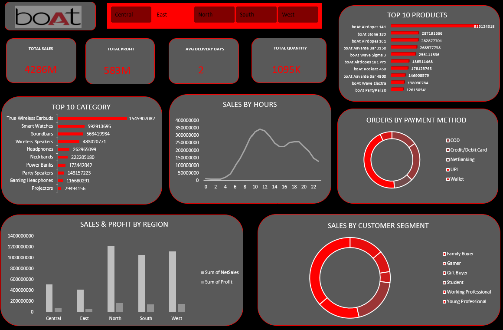

# BoAt-Analytics-Dashboard
An interactive sales analytics dashboard built for boAt (consumer audio and wearables), designed to turn raw sales data into clear business insights.

## Project Overview
This dashboard analyzes sales performance across regions, products, categories, customer segments, and payment methods. It helps identify top-performing products, peak sales hours, and the regions that drive the most revenue and profit.

## Key Metrics (KPIs)
- **Total Sales:** 4286M
- **Total Profit:** 583M
- **Average Delivery Days:** 2
- **Total Quantity Sold:** 1095K

## Dashboard Features
- **Region Slicer:** Filter the whole dashboard by Central, East, North, South, or West
- **Top 10 Products:** Best-selling products by sales (e.g., boAt Airdopes 141, Stone 180, Airdopes 161)
- **Top 10 Categories:** True Wireless Earbuds lead, followed by Smart Watches and Soundbars
- **Sales by Hours:** Hourly sales trend showing the peak around 10-11 AM and a second peak in the evening
- **Orders by Payment Method:** COD, Credit/Debit Card, NetBanking, UPI, and Wallet
- **Sales & Profit by Region:** Comparison of net sales vs. profit across all five regions
- **Sales by Customer Segment:** Family Buyer, Gamer, Gift Buyer, Student, Working Professional, Young Professional

## Key Insights
- True Wireless Earbuds are the largest category by sales.
- The North region generates the highest sales, followed by West and South.
- Sales peak in the late morning, with a second rise in the evening.
- Airdopes 141 is the top-selling product by a wide margin.

## Dashboard Preview

